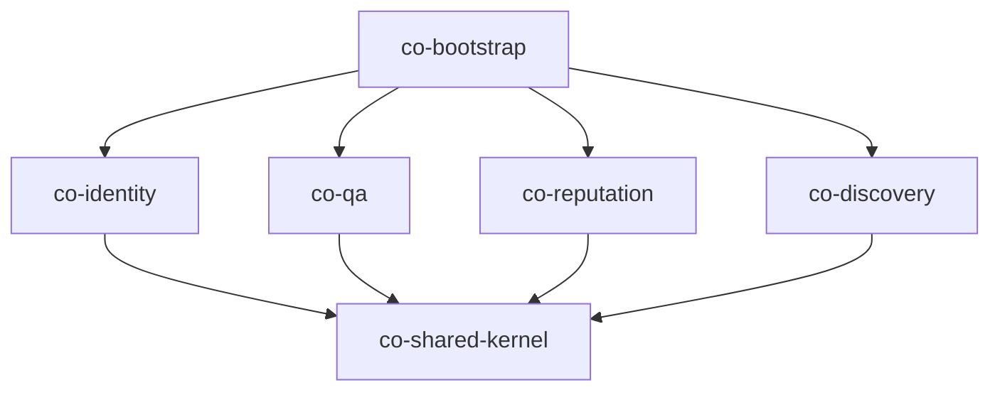

# 架构阅读笔记

> 阅读人：王子昂（SM）｜日期：2026-10-24｜基线 commit：5b47a4d

## 1. 模块地图

项目采用模块化单体 + 六边形分层，顶层分为：

- `co-shared-kernel`：领域异常、Actor、集成事件契约、分页等共享能力
- `co-identity`：身份与认证（完整参考实现）
- `co-qa`：问答核心
- `co-reputation`：声誉与激励
- `co-discovery`：搜索、通知、相关内容
- `co-bootstrap`：启动入口、装配、安全、发件箱中继、演示数据

每个业务上下文内部再分五层：

```text
interfaces  →  application  →  domain
                    ↑
              infrastructure
```

依赖方向由外向内：interfaces 依赖 application，application 依赖 domain；
infrastructure 实现 domain 的仓储端口；bootstrap 负责把所有实现装配起来。



## 2. Identity 参考实现

Identity 是唯一完整实现的上下文，可以当作其余三个上下文的范本。

- 聚合：`User`、`Course`，领域规则放在聚合内部，不依赖 Spring/JPA。
- 注册/登录：账号、邮箱、密码规则在 domain；用例编排在 application。
- 会话：登录成功后写入 Redis，配置见 `spring.session.redis.namespace=co:session`。
- 安全链：`SecurityConfig` 配置认证、CSRF、Cookie；`CsrfCookieFilter` 负责把 CSRF token 写入 Cookie。
- 当前用户：`ActorArgumentResolver` 从会话中解析 Actor，注入 Controller 方法参数。
- 请求路径：Controller → Application Service → Domain → Repository 接口 → Infrastructure 适配器 → MySQL。

关键类：

- `com.campusoverflow.CampusOverflowApplication`
- `com.campusoverflow.bootstrap.security.SecurityConfig`
- `com.campusoverflow.bootstrap.web.ActorArgumentResolver`
- `com.campusoverflow.identity.domain.User`
- `com.campusoverflow.identity.domain.Course`

## 3. 架构约束（ArchUnit FF-1 ~ FF-6）

`co-bootstrap` 的 `ArchitectureTest` 把架构约束写成了可执行测试：

| 编号 | 约束 |
| --- | --- |
| FF-1 | 领域层不依赖 Spring、JPA、Validation、Jackson、Swagger 等框架 |
| FF-2 | 跨上下文只能依赖对方的 `api` 包，不能直接依赖 domain/application/infrastructure/interfaces |
| FF-3 | 上下文之间不允许循环依赖 |
| FF-4 | 六边形分层方向由外向内：Interfaces/Infrastructure 只能被 Bootstrap 访问；Application 可被 Interfaces/Infrastructure/Bootstrap 访问；Domain 可被 Application/Infrastructure/Interfaces/Bootstrap 访问|
| FF-5 | `api` 包是发布语言，只能依赖 JDK、shared-kernel 和 api |
| FF-6 | 每个上下文的表必须使用自己的前缀：`id_`、`qa_`、`rep_`、`dis_` |

额外约束：

- `@RestController` 必须放在 `interfaces` 层；
- `@Entity` 必须放在 `infrastructure` 层，领域模型与 JPA 实体分离（ADR-008）。

## 4. ADR 摘要

| 编号 | 决策 | 状态 |
| --- | --- | --- |
| 002 | 跨上下文集成使用事务性发件箱（outbox） | 已读 |
| 004 | 声誉采用只追加账本 + 对账 | 已读 |
| 007 | 前后端以 OpenAPI 契约协作 | 已读 |
| 008 | 领域对象与 JPA 实体分离 | 已读 |

### 文档缺口

- README 说 `docs/adr/` 有 8 条 ADR，仓库里实际只有 4 条：001、003、005、006 缺失。
- `docs/adr/` 下的中文文件名是乱码（如 `002-浜嬪姟...`），README 里的链接点不开。
- 这两点已记录，后续可由团队补文档或向教师确认。

## 5. 疑问

1. 事务性发件箱是至少一次投递，消费端如何保证幂等？目前看到 `processed_event` 表与账本唯一键的设计，想确认两者的边界。
2. 认证采用 Redis 服务端会话而不是 JWT，横向扩展时 Redis 是单点吗？会话撤销与过期策略如何统一？
3. 声誉账本异步结算，如果中继失败或重复投递，对账任务如何发现并修复差异？
4. `api` 包限制只能依赖 JDK/shared-kernel，后续新增跨上下文查询时，是否必须新建 api 接口而不是复用 application DTO？

## 6. 对后续开发的启示

- 新功能先落 domain 的聚合与不变式，再写 application 用例，最后补 infrastructure 适配器。
- 跨上下文调用只走对方的 `api`，不要直接 import 对方的 domain。
- 新增表必须带上下文前缀，新增实体必须放 infrastructure。
- 写代码前先看对应模块的测试，测试就是需求规格。