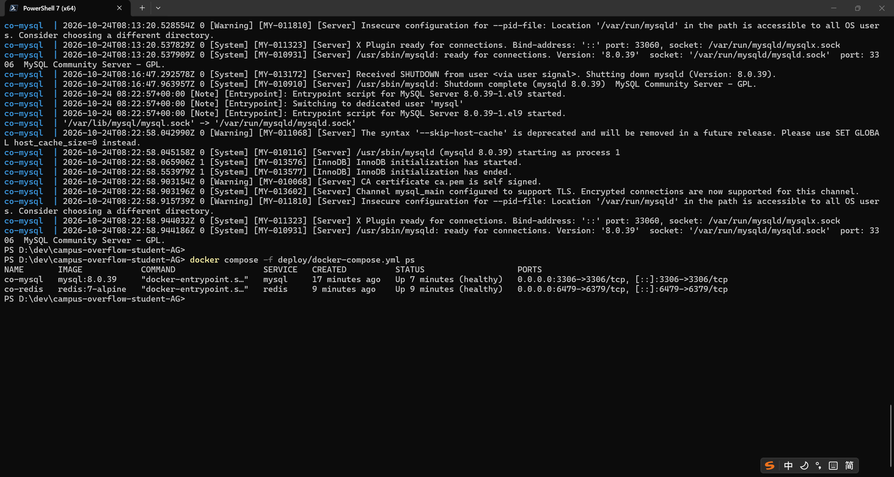
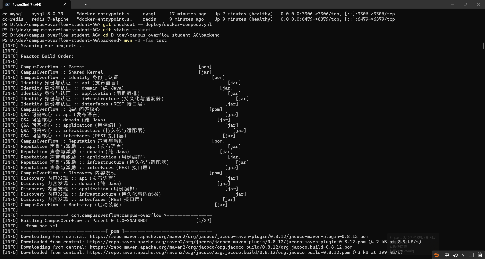
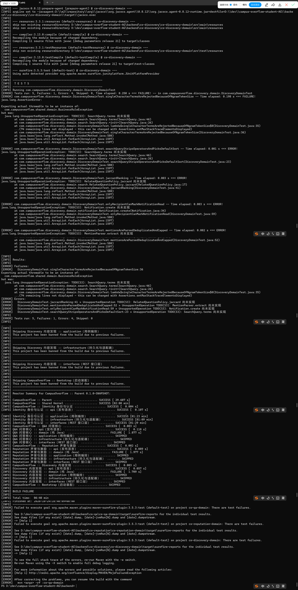

# S0 环境验证

> 验证人：王子昂（SM）｜日期：2026-10-24｜基线 commit：5b47a4d

## 1. 结论

环境通过。`docker compose` 的 MySQL/Redis 均处于 healthy；
`mvn test` 能编译并执行，失败均为 `TODO` 未实现（课程基线），不是环境故障。

## 2. 环境

| 项 | 值 |
| --- | --- |
| OS | Windows 11 |
| JDK | 22.0.2 |
| Maven | 3.9.16 |
| Git | 2.54.0 |
| Docker | 29.9.2 |
| Compose | v5.6.1 |
| 基线 commit | 5b47a4d |

## 3. 中间件

```bash
docker compose -f deploy/docker-compose.yml up -d mysql redis
docker compose -f deploy/docker-compose.yml ps
```

输出：

```text
NAME       SERVICE   STATUS
co-mysql   mysql     Up (healthy)   0.0.0.0:3306->3306/tcp
co-redis   redis     Up (healthy)   0.0.0.0:6479->6379/tcp
```



## 4. 单元测试

```bash
cd backend
mvn -B -fae test
```

关键输出：

```text
[INFO] Running com.campusoverflow.discovery.domain.DiscoveryDomainTest
[ERROR] Tests run: 5, Failures: 1, Errors: 4, Skipped: 0

[INFO] CampusOverflow :: Q&A 问答核心 :: domain (纯 Java) ......... FAILURE
[INFO] CampusOverflow :: Reputation 声誉与激励 :: domain (纯 Java) FAILURE
[INFO] CampusOverflow :: Discovery 内容发现 :: domain (纯 Java) ... FAILURE
[INFO] BUILD FAILURE
```

失败堆栈：

```text
java.lang.UnsupportedOperationException: TODO(S3): SearchQuery.terms 尚未实现
```

说明：Maven 在 `co-qa-domain`、`co-reputation-domain`、`co-discovery-domain` 失败后，
会跳过依赖它们的 application/interfaces/bootstrap 模块，因此本次没有跑完全部 38 个基线失败。
这属于 starter 的预期状态，不是环境问题。




## 5. 复现步骤

1. 启动 Docker Desktop，等 Engine running；
2. 在仓库根目录执行 `docker compose -f deploy/docker-compose.yml up -d mysql redis`；
3. 执行 `mvn -B -fae test`；
4. 看到 `TODO(S2/S3)` 失败即说明环境通过。

## 6. 已知问题

- Windows 保留端口段 `6311–6410` 占用了 6379，本地 Redis 临时映射为 `6479:6379`，compose 文件已还原。
- CI 三次红均为 38 个 TODO 基线，不是环境问题。